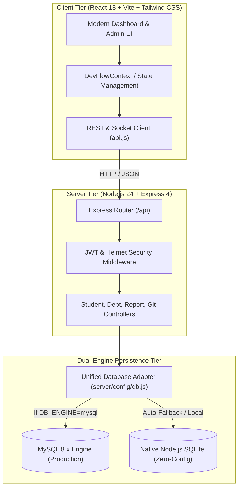

# Student Management System
### *GitHub as an Industry Standard for Collaborative Software Development*

[](.github/workflows/ci.yml)
[](https://nodejs.org)
[](https://react.dev)
[](server/config/db.js)
[](tests/)
[](LICENSE)

---

## Academic Context & Project Charter
- **Institution:** Woxsen University, School of Technology
- **Course Code:** `24TU05IT01`
- **Course Name:** Industry Excellence Track
- **Project Title:** GitHub as an Industry Standard for Collaborative Software Development
- **Lead Repository:** [ranadeepyasa/Student-Management-System](https://github.com/ranadeepyasa/Student-Management-System)
- **Academic Year:** 2026

This repository hosts a production-grade, full-stack **Student Management System** engineered in tandem with a complete industry-standard demonstration of collaborative software development on GitHub. The project fulfills two complementary mandates:
1. **Application Excellence:** A modern web application providing role-based admin authentication, real-time analytics, comprehensive student CRUD operations, academic department governance, dynamic multi-parameter filtering, and automated CSV report generation.
2. **DevOps & Collaborative Excellence:** Demonstration of real-world GitHub workflows including trunk-based integration, feature branching, issue triage, automated continuous integration (CI) matrices, structured pull request reviews, and simulated merge conflict resolution.

---

## 5-Member Engineering Roster & Assigned Workstreams

```
                                  +------------------------------------+
                                  |     RANADEEP YASA (Lead)           |
                                  | Roll No: 24WU0104081               |
                                  | Branching, PRs, Reviews & Conflicts|
                                  +-----------------+------------------+
                                                    |
             +----------------------+---------------+----------------------+----------------------+
             |                      |                                      |                      |
             v                      v                                      v                      v
+------------------------+ +------------------------+   +------------------------+ +------------------------+
|       G. DHARAN        | |      CH. RISHYANT      |   |       B. ABHINAV       | |   P. MUNESWAR REDDY    |
| Roll No: 24WU0102210   | | Roll No: 24WU0102213   |   | Roll No: 24WU0102224   | | Roll No: 24WU0101006   |
| Repo Mgmt & Intro      | | SCM, Commits & History |   | GitHub Issues & Triage | | Releases, CI/CD & Docs |
+------------------------+ +------------------------+   +------------------------+ +------------------------+
```

| Member Name | University Roll No | Assigned Workstream | Dedicated Git Branch | Primary Deliverables |
| :--- | :--- | :--- | :--- | :--- |
| **G. Dharan** | `24WU0102210` | Repository Documentation | `feature/repository-documentation` | Project introduction, architecture diagrams, governance, LICENSE |
| **CH. Rishyant** | `24WU0102213` | Source Code Management | `feature/source-code-management` | SCM standards, directory modularity, commit conventions, `.gitignore` |
| **B. Abhinav** | `24WU0102224` | Issues & Bug Tracking | `feature/issues-and-bug-tracking` | Issue triage taxonomy, YAML templates, 8 project milestone issues |
| **Ranadeep Yasa** | `24WU0104081` | Pull Requests & Reviews | `feature/pull-requests-and-code-review` | PR workflows, review checklist, merge conflict demonstration guide |
| **P. Muneswar Reddy** | `24WU0101006` | Release Management | `feature/release-management` | Release tagging v1.0.0, CHANGELOG, GitHub Actions CI workflow |

*Detailed responsibilities and verification audit trails are documented in [docs/TEAM_CONTRIBUTIONS.md](docs/TEAM_CONTRIBUTIONS.md).*

---

## Core Application Modules

### 1. Secure Admin Authentication
- Admin login with encrypted credential verification (`bcryptjs` salt rounds = 10).
- Session and API authorization using JSON Web Tokens (JWT).
- Protected administrative mutations (`POST`, `PUT`, `DELETE`).
- Persona switcher for evaluating 5 distinct student team member roles.

### 2. Institutional Analytics Dashboard
- Live database-computed KPIs: Total Enrolled Students, Active Students, Campus CGPA Average, Department count.
- Responsive data visualization using Recharts:
  - Department Enrollment Distribution (BarChart).
  - Student Academic Status Breakdown (Donut PieChart).
  - Cohort Progression across Year 1 to Year 4.
- Recent Student Registrations quick-action feed.

### 3. Student Management (Full CRUD)
- **Create:** Modal registration form with client & server-side validation (unique Student ID, email validation, year of study 1–4, CGPA range 0.00–4.00).
- **Read:** Paginated directory with sorting headers (Student ID, Name, Department, Year, GPA, Status).
- **Update:** Full profile editor with immediate state and database synchronization.
- **Delete:** Two-step modal confirmation dialog with activity audit trail logging.
- **Student Profile View:** Dedicated route (`/students/:id`) presenting comprehensive academic history, contact records, emergency contacts, and affiliated department details.

### 4. Academic Department Governance
- Department registry: Department Code (e.g., `CSE`, `AIDS`), Name, HOD, Institutional Email, Phone, Building/Lab Complex.
- **Referential Safety Constraint:** Built-in deletion guard preventing department removal if active students are currently enrolled.

### 5. Multi-Parameter Search & Filtering
- Real-time search across Student ID, First Name, Last Name, Email, and Degree.
- Filter by Academic Department dropdown.
- Filter by Academic Year (Freshman, Sophomore, Junior, Senior).
- Filter by Enrollment Status (`Active`, `Inactive`, `Suspended`, `Graduated`).

### 6. Institutional Reports & CSV Export
- Department-wise analytical metric summaries.
- Year-wise progression matrices.
- One-click RFC-4180 compliant CSV export (`/api/reports/export/students.csv`) with automatic content-disposition download.

---

## System Architecture



---

## Technology Stack

| Layer | Technologies |
| :--- | :--- |
| **Frontend Framework** | React 18.3.1, React Router DOM 7.18.5 |
| **Build & Tooling** | Vite 8.3.5, PostCSS, Oxlint |
| **Styling & Icons** | Tailwind CSS 3.4.19, Lucide React 1.66.0 |
| **Data Visualization**| Recharts 3.10.1 |
| **Backend Runtime** | Node.js v24.18.0 (ES Modules) |
| **HTTP Framework** | Express 4.21.2 |
| **Security & Auth** | JSON Web Tokens (`jsonwebtoken`), `bcryptjs`, `helmet`, `cors`, `express-rate-limit` |
| **Real-Time Sync** | Socket.IO 4.8.1 |
| **Databases** | MySQL 8.x via `mysql2/promise` & Node.js 24 native SQLite (`node:sqlite`) |
| **Testing Engine** | Node.js native test runner (`node:test`, `node:assert`) |
| **CI/CD** | GitHub Actions (`.github/workflows/ci.yml`) |

---

## Getting Started

### Prerequisites
- **Node.js:** v20.x, v22.x, or v24.x (v24.18.0 recommended)
- **npm:** v10.x or v11.x
- **Git:** v2.40+
- *(Optional)* **MySQL:** 8.0+ on port 3306 (if not running, application seamlessly uses embedded SQLite).

### Installation & Execution

1. **Clone the Repository:**
   ```bash
   git clone https://github.com/ranadeepyasa/Student-Management-System.git
   cd Student-Management-System
   ```

2. **Install Root & Server Dependencies:**
   ```bash
   npm install
   cd server && npm install && cd ..
   ```

3. **Configure Environment Variables:**
   ```bash
   # Copy sample environment configuration
   cp .env.example .env
   cp server/.env.example server/.env
   ```

4. **Run Backend API Server:**
   ```bash
   cd server
   npm start
   ```
   *The backend starts at `http://localhost:5000` and automatically initializes the database schema with sample student seed records.*

5. **Run Frontend Application:**
   ```bash
   # In a separate terminal at repository root:
   npm run dev
   ```
   *Open `http://localhost:5173` in your browser.*

6. **Default Demo Admin Credentials:**
   - **Username / Email:** `admin` or `admin@woxsen.edu.in`
   - **Password:** `Admin@Woxsen2026!`

---

## Automated Software Testing

The project includes 31 automated unit and integration tests across 8 comprehensive suites covering authentication, CRUD operations, referential safety, search algorithms, reporting, and Git workflow validation.

```bash
# Execute the full automated test suite
npm test
```

### Verified Test Suite Breakdown:
- `tests/studentManagement.test.js` (8 tests: CRUD, duplicate prevention, 400 validation, search, filter, update, delete).
- `tests/departmentOperations.test.js` (4 tests: Listing, creation, duplicate codes, safe delete constraint).
- `tests/authentication.test.js` (5 tests: Valid login, bad password, missing fields, token generation, protected routes).
- `tests/reportsAndAnalytics.test.js` (2 tests: Dashboard stats computation, RFC-4180 CSV export).
- `tests/architecture.test.js` (4 tests: Directory structure, configuration files, `.gitignore` safety, `package.json`).
- `tests/teamContributions.test.js` (2 tests: 5-member roster validation, mock data synchronization).
- `tests/githubWorkflows.test.js` (3 tests: Issue templates, PR templates, CI workflow validation).
- `tests/apiEndpoints.test.js` (3 tests: Express middleware contracts, database schema, GitHub service integration).

---

## GitHub Collaborative Development Demonstration

| Practice | Documentation Reference | Implementation Description |
| :--- | :--- | :--- |
| **Branching Strategy** | [docs/BRANCHING_STRATEGY.md](docs/BRANCHING_STRATEGY.md) | 5 dedicated feature branches matching student workstreams + `main` stable branch |
| **Issue Tracking** | [docs/ISSUE_TRACKING_GUIDE.md](docs/ISSUE_TRACKING_GUIDE.md) | Standardized issue templates and 8 project milestone issues |
| **Pull Request Review**| [docs/PULL_REQUEST_GUIDE.md](docs/PULL_REQUEST_GUIDE.md) | Structured PR templates with 6-point verification checklists |
| **Code Review Standards**| [docs/CODE_REVIEW_GUIDE.md](docs/CODE_REVIEW_GUIDE.md) | Line-by-line inspection, comment etiquette, change requests, and approval |
| **Merge Conflicts** | [docs/MERGE_CONFLICT_GUIDE.md](docs/MERGE_CONFLICT_GUIDE.md) | 3-way merge conflict simulation and step-by-step resolution tutorial |
| **Release Management** | [docs/RELEASE_NOTES.md](docs/RELEASE_NOTES.md) | Semantic Versioning (`v1.0.0`), CHANGELOG, and release distribution |
| **CI Automation** | [.github/workflows/ci.yml](.github/workflows/ci.yml) | GitHub Actions multi-version matrix validating build and automated tests |

---

## Project Documentation Index

- [docs/PROJECT_AUDIT.md](docs/PROJECT_AUDIT.md): Comprehensive baseline assessment of initial codebase.
- [docs/PROJECT_OBJECTIVES.md](docs/PROJECT_OBJECTIVES.md): Academic goals, syllabus alignment, and pedagogical milestones.
- [docs/METHODOLOGY.md](docs/METHODOLOGY.md): Collaborative engineering methodology and Agile sprint structure.
- [docs/SYSTEM_ARCHITECTURE.md](docs/SYSTEM_ARCHITECTURE.md): Multi-tier architecture, sequence diagrams, and schema.
- [docs/IMPLEMENTATION.md](docs/IMPLEMENTATION.md): Detailed full-stack implementation breakdown of all application modules.
- [docs/TESTING.md](docs/TESTING.md): Test plan, coverage metrics, and validation strategy.
- [docs/TEAM_CONTRIBUTIONS.md](docs/TEAM_CONTRIBUTIONS.md): 5-member team charter and verified contributions.
- [docs/GIT_WORKFLOW.md](docs/GIT_WORKFLOW.md): Version control standards, commit hygiene, and branching models.
- [docs/BRANCHING_STRATEGY.md](docs/BRANCHING_STRATEGY.md): Comprehensive branch lifecycle and integration rules.
- [docs/ISSUE_TRACKING_GUIDE.md](docs/ISSUE_TRACKING_GUIDE.md): Issue triage, labels, SLAs, and milestone management.
- [docs/PULL_REQUEST_GUIDE.md](docs/PULL_REQUEST_GUIDE.md): Pull request lifecycle, templates, and traceability.
- [docs/CODE_REVIEW_GUIDE.md](docs/CODE_REVIEW_GUIDE.md): Peer review protocols, inspection standards, and approvals.
- [docs/MERGE_CONFLICT_GUIDE.md](docs/MERGE_CONFLICT_GUIDE.md): Safe simulation and resolution of Git merge conflicts.
- [docs/RELEASE_NOTES.md](docs/RELEASE_NOTES.md): Official release notes for stable release v1.0.0.
- [docs/FUTURE_SCOPE.md](docs/FUTURE_SCOPE.md): Future technical expansions, AI integrations, and mobile clients.
- [CHANGELOG.md](CHANGELOG.md): Chronological version history and change logs.
- [docs/FINAL_IMPLEMENTATION_REPORT.md](docs/FINAL_IMPLEMENTATION_REPORT.md): Final comprehensive course completion report.

---

## License
This project is open-source and licensed under the [MIT License](LICENSE).
