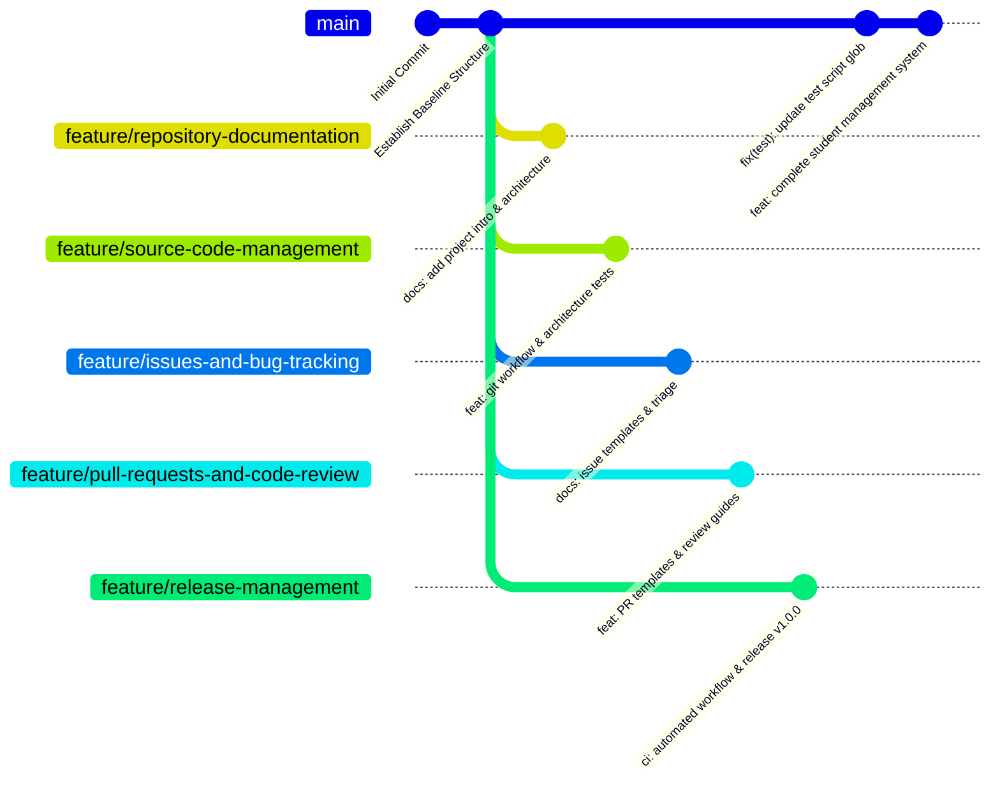

# Branching Strategy & Workstream Management

**Course Code:** 24TU05IT01  
**Course Title:** Industry Excellence Track  
**Academic Institution:** Woxsen University  
**Project Title:** GitHub as an Industry Standard for Collaborative Software Development  

---

## 1. Branching Topology

To reflect modern software engineering division of labor, our repository utilizes a **5-tier feature workstream branching strategy** rooted in the protected `main` branch.

---

## 2. Team Workstream Mapping

### Workstream 1: Repository Documentation
- **Branch:** `feature/repository-documentation`
- **Owner:** G. Dharan (`24WU0102210`)
- **Scope:** Project charter, problem statement, architecture manuals, and open-source licensing.

### Workstream 2: Source Code Management
- **Branch:** `feature/source-code-management`
- **Owner:** CH. Rishyant (`24WU0102213`)
- **Scope:** Directory modularity, `.gitignore` credentials isolation, commit standards, and SCM testing.

### Workstream 3: Issues and Bug Tracking
- **Branch:** `feature/issues-and-bug-tracking`
- **Owner:** B. Abhinav (`24WU0102224`)
- **Scope:** YAML issue templates, triage lifecycle taxonomy, label dictionaries, and issue-to-commit links.

### Workstream 4: Pull Requests and Code Review
- **Branch:** `feature/pull-requests-and-code-review`
- **Owner:** Y. Ranadeep Reddy (`24WU0104081`)
- **Scope:** Pull request checklists, peer review guidelines, constructive feedback criteria, and merge conflict resolution simulation.

### Workstream 5: Release Management
- **Branch:** `feature/release-management`
- **Owner:** P. Muneswar Reddy (`24WU0101006`)
- **Scope:** Semantic Versioning (`v1.0.0`), CHANGELOG history, automated GitHub Actions CI pipelines, and deployment readiness.

---

## 3. Branch Protection & Integration Rules

1. **`main` is Protected:** No team member is permitted to force-push (`git push --force`) or delete the `main` branch.
2. **Pull Requests Required:** All feature integration must be mediated through an open Pull Request.
3. **Automated CI Passing:** The GitHub Actions CI pipeline must execute and pass all 31 tests before merge approval.
4. **Peer Review Approval:** At least one independent review sign-off is mandatory.
