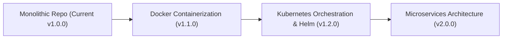

# Future Scope & Technical Expansion Roadmap

**Course Code:** 24TU05IT01  
**Course Title:** Industry Excellence Track  
**Academic Institution:** Woxsen University  
**Project Title:** GitHub as an Industry Standard for Collaborative Software Development  
**Lead Contributor:** P. Muneswar Reddy (Roll Number: 24WU0101006)  
**Workstream:** Software Release Management, Versioning & Verification  

---

## 1. Technical Vision

While version `v1.0.0` delivers a complete, production-ready Student Management System and fulfills all course objectives, software systems in enterprise environments continuously evolve. This document outlines strategic architectural enhancements planned for subsequent release cycles (`v1.1.0` through `v2.0.0`).

---

## 2. Planned Functional Enhancements

### A. Student Self-Service Portal & Course Registration
- **Role-Based Portals:** Introduce separate portals for Students, Faculty Advisors, and Registrars.
- **Course Enrollment & Prerequisite Engine:** Automated semester course selection, credit load validation, and automated prerequisite checking.
- **Attendance & Timetable Tracking:** Real-time timetable management and attendance tracking with threshold alerts (e.g. warning when attendance falls below 75%).

### B. Examination, Grading & Transcripts
- **Grade Book Module:** Secure entry of internal assessments, midterms, and final examination marks.
- **Automated GPA/CGPA Calculator:** Automated grade point average computations compliant with University grading criteria.
- **Cryptographically Signed Digital Transcripts:** PDF transcript generation featuring verifiable QR code hashes.

### C. Fee Management & Accounting Integration
- **Fee Invoicing:** Departmental tuition fee schedules, installment tracking, scholarship fee waivers.
- **Payment Gateway Integration:** Secure payment processing with Stripe and Razorpay.

---

## 3. DevOps & Infrastructure Evolution

### A. Docker Containerization
- Authoring multi-stage `Dockerfile` and `docker-compose.yml` defining synchronized containers for the React frontend, Node.js API server, and MySQL database.

### B. Advanced CI/CD GitOps
- Implementing GitHub Actions deployment to Kubernetes clusters via ArgoCD.
- Adding automated security vulnerability scans (Snyk / GitHub Dependabot) and static code analysis (SonarQube).

### C. Native Mobile Companion App
- Developing cross-platform iOS and Android applications utilizing React Native or Flutter, communicating with the existing Express REST API.
