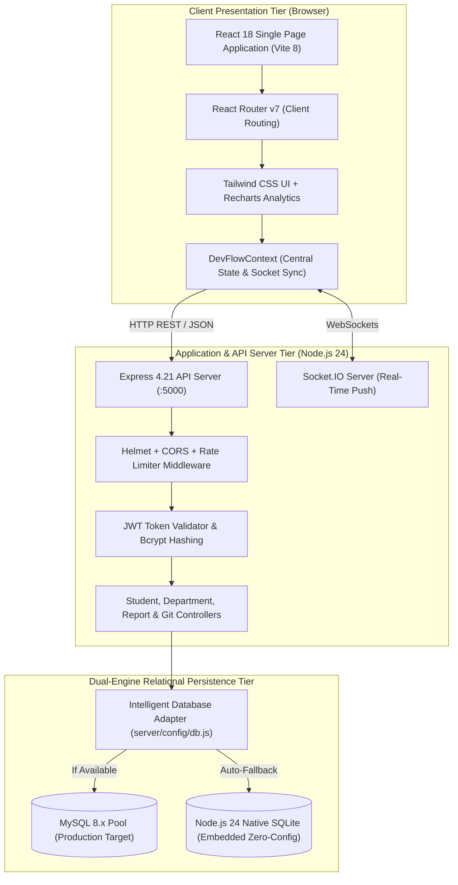
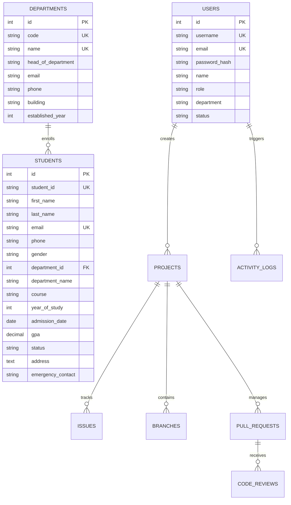

# System Architecture & Technical Design

**Course Code:** 24TU05IT01  
**Course Title:** Industry Excellence Track  
**Academic Institution:** Woxsen University  
**Project Title:** GitHub as an Industry Standard for Collaborative Software Development  

---

## 1. High-Level Architecture Overview

The **Student Management System** is built on a decoupled, modern three-tier client-server architecture designed for high maintainability, responsive user experience, and flexible persistence.

---

## 2. Component Design & Layer Responsibilities

### A. Presentation Layer (`src/`)
- **Pages:**
  - `DashboardPage.jsx`: Executive analytics, KPI summary cards, department distribution charts, recent registrations.
  - `StudentsPage.jsx`: Full student directory with search, filtering, sorting, add/edit modal, delete confirmation.
  - `StudentDetailPage.jsx`: Comprehensive student profile view with academic details, contact records, and affiliated department data.
  - `DepartmentsPage.jsx`: Department management cards with referential delete protection and faculty details.
  - `ReportsPage.jsx`: Analytical reports, cohort breakdowns, and one-click CSV export.
  - Collaborative Git views: `RepositoriesPage.jsx`, `BranchesPage.jsx`, `IssuesPage.jsx`, `PullRequestsPage.jsx`, `CodeReviewsPage.jsx`, `ReleasesPage.jsx`, `TeamPage.jsx`.
- **State Management:** `DevFlowContext.jsx` manages reactive global state, fallback caching, and Socket.IO real-time event subscriptions.
- **Service Layer:** `api.js` centralizes fetch requests, JWT authorization headers, and error handling.

### B. Business Logic & API Layer (`server/`)
- **REST Endpoints:**
  - `/api/auth`: Login, token validation, persona switching.
  - `/api/students`: CRUD, search, filter, sort, and detail queries.
  - `/api/departments`: CRUD, student capacity metrics, safe delete guard.
  - `/api/reports`: Analytical aggregations and RFC-4180 CSV export.
  - `/api/projects`, `/api/issues`, `/api/branches`, `/api/pull-requests`, `/api/releases`: Collaborative Git tracking.
- **Security Middleware:**
  - `helmet`: Sets HTTP security headers (`X-Content-Type-Options`, `X-Frame-Options`, `X-XSS-Protection`).
  - `cors`: Configured for localhost, preview URLs, and permissive academic multi-laptop testing.
  - `express-rate-limit`: Prevents brute-force denial of service.
  - `authenticate` middleware: Validates JWT Bearer tokens and extracts authenticated user details.

### C. Data Persistence Layer (`server/config/db.js`)
- **Dual-Engine Relational Architecture:**
  1. **MySQL 8.x Engine:** Connects via `mysql2/promise` connection pool for high-concurrency production deployments.
  2. **Native Node.js SQLite (`node:sqlite`):** Automatically activated when MySQL is not detected or running. Operates using WAL (Write-Ahead Logging) mode and busy timeouts for high-concurrency automated testing without database lock errors.
- **Unified Query Adapter:** Exposes identical `pool.query(sql, params)` returning `[rows, fields]` and `pool.getConnection()`, ensuring zero code differences between database engines.

---

## 3. Relational Database Schema & Entity Relationships

